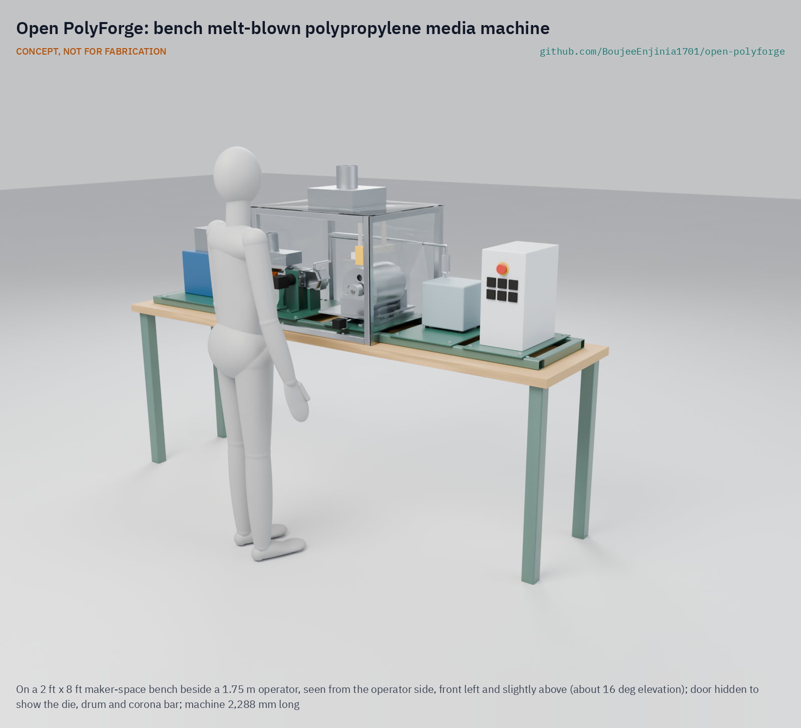
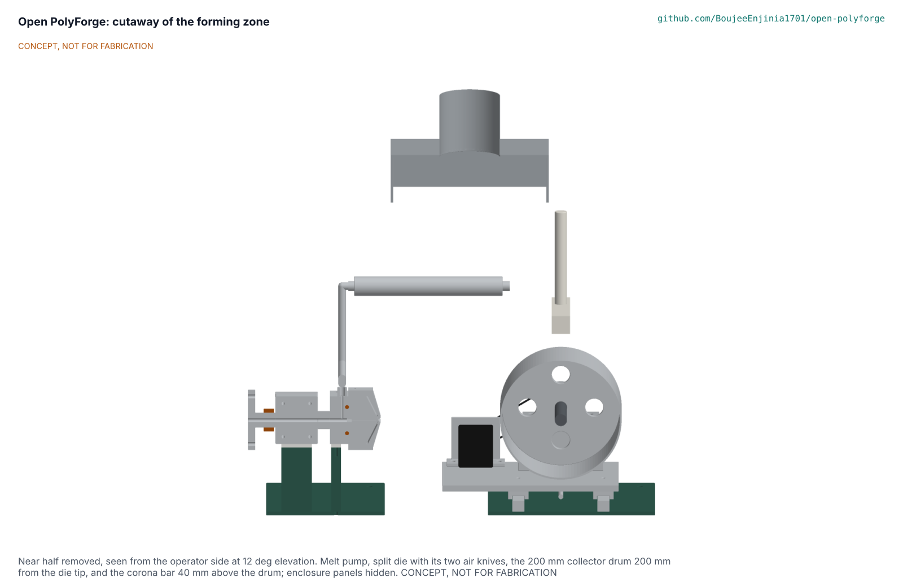
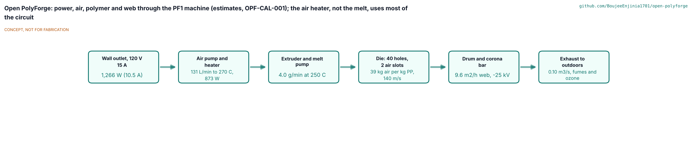
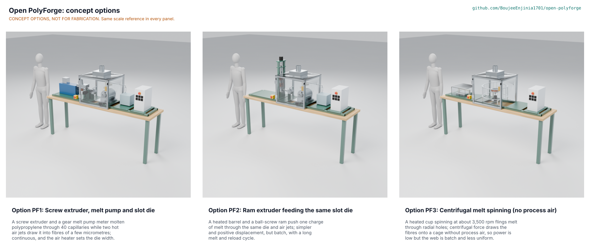
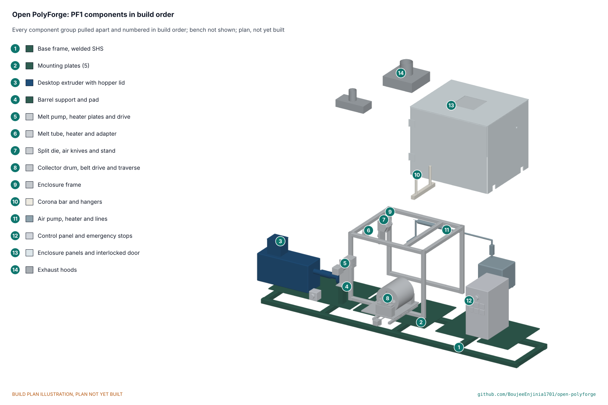

# Open PolyForge



CONCEPT, NOT FOR FABRICATION. [Studio view](media/render-studio.png) · [Exploded render](media/render-exploded.png) · [Concept render](media/hero.png)

    [](https://github.com/BoujeeEnjinia1701/open-polyforge/actions/workflows/reuse.yml)

**Area:** Supply chain resilience · **TRL:** 3 of 9 (proof of concept on paper; stage P3) · **Value-engineering target:** USD 10,000 per machine, proposed (estimate USD 14,075.15) · **Difficulty:** 5 of 5 · **Partner:** Helpful Engineering

An open, bench-top machine that makes electrostatically charged melt-blown polypropylene web from standard resin on one 120 V, 15 A circuit: a desktop screw extruder and a gear melt pump feed a 40-hole slot die, hot air draws the melt into fibres of a few micrometres onto a traversing drum, and a corona bar charges the web. It makes filter media for testing, not masks or respirators. The choice between this machine (PF1) and a centrifugal melt spinner (PF3) is **proposed, awaiting Amish**.

[Hero (concept render)](media/hero.png) · [Cutaway](media/cutaway.png) · [Exploded view](media/exploded.png) · [Power and material flow](media/flow.png) · [Interactive 3D model](media/viewer.html) · [Concept blueprint (PDF)](media/concept-blueprint.pdf) · [General arrangement OPF-DWG-001 (PDF)](cad/drawings/OPF-DWG-001.pdf) · [Half section OPF-DWG-002 (PDF)](cad/drawings/OPF-DWG-002.pdf) · [Sizing note OPF-CAL-001](docs/04-calcs/01-sizing.md) · [STEM check](docs/01b-stem-check.md) · [Prototype build plan](docs/05-build-plan.md) · [Decisions](docs/06-design-decisions.md) · [Review](docs/REVIEW.md)

## Concept rationale

Melt blowing is mostly air. To draw a thread of polypropylene into a fibre a few micrometres across, a melt-blowing die blows about 40 times the polymer's mass in hot air past each hole; heating that air, not melting the plastic, is where the power goes. At 270 C and 140 m/s each millimetre of air slot costs about 14 W, so one 120 V, 15 A circuit (1,440 W continuous) carries a slot of about 56 mm, not a laboratory die. This machine keeps the Helpful Engineering proposal's process (screw extruder, precision die, hot air, drum, corona charging) and sizes the die to the wall outlet: 40 capillaries, two 48 mm slots, 4 g/min of polymer.

Design thesis: **size the die to the outlet, meter the melt, guard everything hot, charged or moving.**

## Burning platform

- In March 2020 melt-blown fabric in China rose from under USD 6,000 to about USD 60,000 a tonne, and one industrial line cost upward of EUR 3.8 million and took at least five to six months to make ([NPR](https://www.kunc.org/npr-news/2020-03-16/covid-19-has-caused-a-shortage-of-face-masks-but-theyre-surprisingly-hard-to-make), checked 2026-11-12).
- Mask makers reported melt-blown prices rising from CNY 20,000 to CNY 300,000 to 400,000 a tonne in early 2020 ([Yicai Global](https://yicaiglobal.com/news/china-mask-makers-see-raw-material-prices-soar-20-fold-on-supply-bottlenecks), checked 2026-11-12).
- A conventional melt-blowing facility costs USD 0.1 to 1 million and months to deploy ([Molina et al. 2022](https://rcastoragev2.blob.core.windows.net/f7a4c484a3a6a85ae30da4d11485fa82/PMC9017944.pdf), checked 2026-11-12): local groups have no documented, buildable alternative.

## Where it could be used

### By industry

| Industry | Use |
| --- | --- |
| Universities and research labs | Making and characterising charged melt-blown media in small lots |
| Maker spaces and community fabrication labs | A documented, reproducible build that preserves the know-how |
| Emergency preparedness (NGOs, public sector) | Pre-positioned capacity and skills for a future respiratory outbreak |
| Downstream filtration projects | Test media of measured properties for their own development and certification |

### By country or region

| Country or region | Why it matters there |
| --- | --- |
| North America (Ann Arbor maker space and University of Michigan contacts in the proposal) | First build site; 120 V, 15 A design basis |
| Regions with capable fabrication communities but no melt-blown lines | Local capacity when imports stop |
| 230 V regions | The same budget gives more power per circuit (to check against local codes) |

## What sparked the idea

Helpful Engineering's "Melt-Blown Polypropylene Machine" concept proposal (v0.1, 2026-09-15; product lead Brian Finch, program manager Ali Raza, project engineer Bart Combee) set out to make an open, maker-space-compatible machine that produces and charges melt-blown PP, after COVID-19 showed how concentrated the media supply chain is. Amish named the repo Open PolyForge; Design Molecule Labs takes the proposal to a constructable design at TRL 3 and tests its physics.

## Problem

In COVID-19, respirator shortages came partly from scarce melt-blown polypropylene media: the resin is plentiful, but the lines and the know-how sit in a few large plants that take months to build. Maker spaces, universities and local manufacturers have no documented, buildable way to make and charge melt-blown media when supply fails ([OPF-PRB-001](docs/01-problem.md)).

## Concept



The extruder melts the resin (MFR 1,550 g/10 min) to 250 C; a 0.16 cm3/rev gear pump at about 34 rpm meters 4 g/min into a split stainless die, where 40 grooves 0.27 mm square carry it to the nose. Two air knives blow 2.62 g/s of 270 C air at about 140 m/s along the nose, drawing the melt into fibres targeted at 1 to 5 um onto a 200 mm drum 200 mm away, traversing to build a 140 mm sheet at 25 g/m2. A -25 kV needle bar charges the web. Everything hot, charged or moving is inside a guard-locked, exhausted enclosure. It draws about **1,331 W (11.1 A)** steady under a load manager that caps the line at 12 A, and gives about **1.9 to 2.5 m2/h** of sheets once doffing is counted ([OPF-PRC-001](docs/02-concept.md), [OPF-CAL-001](docs/04-calcs/01-sizing.md)).



## Concept options

Three working principles were modelled at detail level D3 and scored ([OPF-OPT-001](docs/02a-concept-options.md)): **PF3 centrifugal melt spinning (187 of 255)**, PF1 the proposal's screw extruder, melt pump and slot die (171) and PF2 a ram extruder into the same die (164). PF3 and PF1 are within 10 %, so both go to Amish without a pick. PF3 is cheaper and uses about half the power, but the one published web from that principle has a filtration quality factor 5.5 times below a reference respirator's media, and choosing it changes the project from melt blowing to centrifugal spinning. PF1 is carried in the drawing set so a constructable design exists.



## STEM check

[OPF-STM-001](docs/01b-stem-check.md): PF1 sits within known science once the die is sized to the supply. The power budget failed for a laboratory-width die (150 mm would draw about 3,061 W, 25.5 A) and was fixed under Amish's standing instruction by narrowing the die to two 48 mm slots with a current-limiting load manager. An independent reviewer agent attacked every verdict on 2026-11-12 (of 28 rows marked within known science, 14 held, 13 were weak and 1 was refuted, and it found 27 missed claims); its strongest finding, that an air knife along the whole nose face needs more pressure than the pump makes, was confirmed and fixed with a 5 mm land and plenum. Ten fixes in all; 35 rows wait on TRL 4 measurements; the machine's nameplate marking on a 15 A circuit goes to Amish (D2). `stem_check: open`.

## Key components

A welded 40 x 3 mm steel tube base frame with five 6 mm plates; a bought 5/8 in desktop screw extruder; a bought 0.16 cm3/rev melt gear pump with machined heater plates and a stepper drive; a split stainless die and two air knives, the only precision parts; a 200 mm aluminium collector drum on a belt-driven, traversing carriage; an acetal corona bar with 14 needles and a 0 to -30 kV, 1 mA supply; a 200 NL/min linear diaphragm air pump and a 1,000 W inline heater; an aluminium and polycarbonate enclosure with a guard-locked door and two exhaust hoods; a control panel with PID zones, a load manager and two emergency stops. Parts USD 14,075.15 ([bom/bom.csv](bom/bom.csv)); about 148 kg.

## Building the prototype

The [prototype build plan](docs/05-build-plan.md) (OPF-BLD-001) shows how to weld the frame, have the die halves and knives machined, turn the melt parts, make the drum, carriage, corona bar, enclosure and hoods, and assemble the machine in eleven steps, each with a picture. Safety stops come before power, first heat, air heat, melt and high voltage. It is a plan, not yet built.



## Safety

The machine carries mains voltage, heaters up to 430 C, molten polymer at 250 C, hot air jets, high voltage to 30 kV and moving machinery, and it is for technically capable operators only. Everything hot, charged or moving is inside a guard-locked enclosure; opening it stops the drum and traverse and removes high voltage, and the bar is grounded before anyone reaches in. Two emergency stops remove heater, motor and high-voltage power; each heater has an independent 300 C cut-out and the air heater cuts out on low flow. Fumes and ozone are exhausted to outdoors and an ozone monitor sits at the operator. Polypropylene fly is combustible: clean it each shift and keep an extinguisher at the bench. A qualified electrician inspects the panel before first power.

## Claims and limits

From the claims register [OPF-CLM-001](docs/12-claims.md):

- **May say now (design intent):** a machine that makes melt-blown polypropylene web; corona charged; designed to run on one 120 V, 15 A circuit with a load manager; targets fibres of 1 to 5 um at 25 g/m2.
- **Only after laboratory testing:** measured filtration efficiency at 0.3 um (NaCl, stated flow) with measured pressure drop and charge decay; measured output and fibre diameter.
- **Never:** that the machine or its media is certified, approved, medical-grade or respirator-grade, offers 100 % filtration or protects against any disease.
- **Limits:** workshop equipment, concept prototype; media properties vary run to run and the charge decays with heat and humidity; respirator standards (NIOSH 42 CFR Part 84, EN 149, GB 2626) are only the downstream benchmarks a finished respirator would need.
- **Release limitation:** no media from a prototype machine is used in a mask or respirator until its efficiency, pressure drop and charge decay are measured by a qualified laboratory and the finished product is certified.

## Helpful Engineering

This is a joint project of Design Molecule Labs and [Helpful Engineering](https://helpfulengineering.org), the global open engineering community. The Helpful Engineering project team's concept proposal "Melt-Blown Polypropylene Machine" (v0.1, 2026-09-15: the challenge, the proposed solution, users, the 12, 30 and 30-plus month roadmap, capability gaps and support needs) is the source of this design; their main path is option PF1 here, their plunger alternative is PF2, and their plan, support needs and partners carry into [OPF-PLN-001](docs/11-plan.md).

## Repository layout

```
docs/                       controlled documents (PRB, STM, PRC, OPT, URS, PRS, RTM, CAL, BLD, DEC, REG, FEA, RSK, MKT, PLN, CLM, VER, FTO) and REVIEW.md
docs/04-calcs/              sizing.py (OPF-CAL-001), stem_check.py, results
docs/decisions/             decision records (concept selection, design for construction, STEM fixes)
docs/05-build-plan/         build plan pictures
cad/src/model.py            parametric model, options PF1 to PF3 at detail level D3 (kit 1.9)
cad/src/sheets.py           drawings OPF-DWG-001 and 002, STL export
cad/src/build_plan_media.py build plan pictures and making sketches OPF-DWG-101 to 110
cad/src/concept_media.py    hero, cutaway, exploded, flow, 3D viewer, concept blueprint
cad/src/product_model.py    appearance model and render views (for Blender)
cad/step/, cad/stl/, cad/drawings/   exports
bom/bom.csv                 priced bill of materials
.kit/                       shared documentation kit 1.9.1-he (do not edit here)
```

## Documentation

Controlled documents follow the portfolio standards in [.kit/STANDARDS.md](.kit/STANDARDS.md), including the Helpful Engineering profile (section 25). `python .kit/render.py --check` validates them, `python .kit/cad_check.py --export` runs the CAD fidelity check, `python docs/04-calcs/sizing.py` and `python docs/04-calcs/stem_check.py` rerun the calculations, and `python .kit/trace.py` regenerates the traceability matrix.

## Credits

Brian Finch, Bart Combee, Amish Chadha, Ali Raza, Lillian Fernandes and Raksha Thammaiah (Design Molecule Labs with Helpful Engineering). AI assistance (Claude) was used for research, calculations, CAD and documentation; design direction and all decisions are Amish Chadha's, recorded in [docs/06-design-decisions.md](docs/06-design-decisions.md).

## Licenses

Following the [Helpful Engineering licensing guide](https://helpfulengineering.org/licensing-guide/):

- Hardware (CAD sources, STEP, drawings, BOM, build plan pictures): CERN-OHL-P-2.0, [LICENSE-HARDWARE.txt](LICENSE-HARDWARE.txt)
- Software (calculation scripts, kit tools, web viewer): Apache-2.0, [LICENSE-SOFTWARE.txt](LICENSE-SOFTWARE.txt)
- Documentation (controlled documents, README, renders and concept pictures): CC-BY-4.0, [LICENSE-DOCUMENTATION.txt](LICENSE-DOCUMENTATION.txt)

---

Design Molecule Labs with Helpful Engineering
