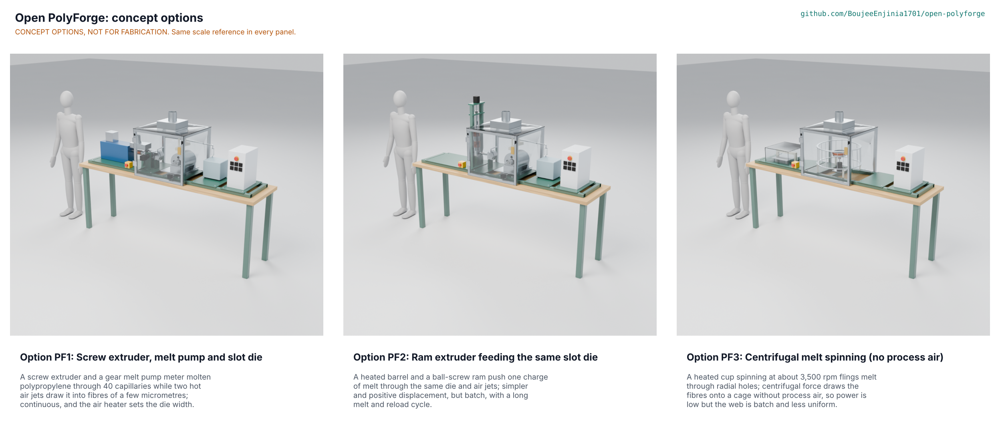

# Open PolyForge concept options

Result: centrifugal melt spinning (PF3) scores 187 of 255, the proposal's screw extruder, melt pump and slot die (PF1) 171 and the ram extruder (PF2) 164. PF1 is 8.6 % below PF3, inside the 10 % band, so **PF3 and PF1 go to Amish without a pick** (STANDARDS section 21; OPF-DEC-001 D1). PF2 is 12.3 % below and is not put forward. The scores hide a sharp trade: PF3 wins on power (about 700 W against 1,331 W), cost and simplicity, but the only published web from this principle has a filtration quality factor 5.5 times below a reference respirator's media (OPF-STM-001 X8), and it would change the project's working principle from melt blowing to centrifugal spinning. PF1 is the proposal's path and the one with an established route to filtration-grade web; it is carried in the drawing set, BOM and build plan so that a constructable design exists at TRL 3. That is not a choice. Method: STANDARDS section 21; numbers from OPF-CAL-001.

Figure 1. The three options at one scale (Blender render, to be produced from `/home/claude/he5/renderq/open-polyforge`).

## The options

### Option PF1: screw extruder, melt pump and slot die (the proposal's main path)

A desktop single-screw extruder (5/8 in screw) feeds a heated 0.16 cm3/rev melt gear pump, which meters 4 g/min into a split stainless die with 40 grooved capillaries (0.27 mm square, 1 mm pitch). Two air knives with 5 mm lands at 0.3 mm form 48 mm slots; 2.62 g/s of air from a linear diaphragm pump, heated to 270 C by a 1 kW inline heater, draws the melt into fibres onto a 200 mm drum 200 mm away, traversing +-40 mm. A -25 kV needle bar charges the web on the drum. Everything hot or moving sits on a welded base frame inside a guard-locked, exhausted polycarbonate enclosure; the extruder sits outside under a branch hood. 315 parts at D3.

### Option PF2: ram extruder feeding the same die

A heated 17-4PH barrel (30 mm bore, 200 mm stroke) on a two-column frame with a ball-screw ram replaces the extruder and the melt pump; the die, air system, drum, corona bar and enclosure are those of PF1. Positive displacement with no screw, but one 78 g charge per cycle. 271 parts at D3.

### Option PF3: centrifugal melt spinning (no process air)

A heated 150 mm stainless ring with 12 radial 0.6 mm holes spins at 3,500 rpm on a vertical brushless spindle inside a 500 mm grounded rod cage, as demonstrated by Molina et al. (2022). Fibres form by centrifugal drawing with no hot air. The cut web is charged on a separate corona table. 192 parts at D3.

## First-order numbers

Table 1. Options compared (OPF-CAL-001, model).

| Quantity | PF1 | PF2 | PF3 |
| --- | --- | --- | --- |
| Estimated parts (USD, prototype) | 14,075.15 (BOM) | About 10,000 (no extruder or melt pump; heated barrel and ram; estimate) | About 4,000 (spindle, ring, cage, corona table, enclosure, panel; estimate) |
| Steady power (W, nominal) | 1,331 (11.1 A) | About 1,250 | About 690 to 790 |
| Polymer rate | 4 g/min continuous | 4 g/min, die running at most about 32 % of the time | About 12.5 g/min in 2 min batches |
| Web output | 1.9 to 2.5 m2/h of sheets (9.6 laid) | About a third of PF1 | Batch; uneven, to measure |
| Fibre diameter | 1 to 5 um target (melt-blown practice) | As PF1 | 3.4 to 5.2 um mean, SD 3 to 5 um (published) |
| Published media quality | Commercial melt-blown benchmarks | As PF1 | Quality factor 0.0018 per Pa against 0.0100 for the reference (X8) |
| Mass (kg, model) | 148 | 150 | 96 |
| Parts count (model) | 315 | 271 | 192 |
| Precision parts | Die halves and knives | Die, barrel and piston | None beyond drilling the ring |
| STEM check | Holds; F1 to F10 made | Holds; batch and trapped-air risks | X8 fails (media quality); not carried |

## Patent check (OPF-FTO-001)

PF1's die nose and corona charging rest on expired patents (Exxon US 3,825,380; Wadsworth and Hersh US 4,375,718). A current die-tip patent (US 11,447,893 B2, Extrusion Group, active to 2040) covers a die tip assembly with impingement surfaces in the air channels; PF1's plain split die and flat knives were not compared against its claims, which were not read in full. PF3's split spinneret would come close to the University of Texas centrifugal spinning patents (US 8,231,378 B2 and US 8,828,294 B2, active); PF3 uses a one-piece drilled ring, which a desk reading suggests is different, to confirm. Not legal advice.

## Scoring

Table 2. Weighted scoring (weights: High UR 3, Medium 2, Low 1; scores 1 to 5). Maximum 255.

| Criterion | Source | Weight | PF1 | PF2 | PF3 | Reason |
| --- | --- | --- | --- | --- | --- | --- |
| Fine-fibre web | UR-001 | 3 | 4 | 3 | 2 | Melt blowing at 0.1 g/hole/min and an air ratio of 39 is the established route; PF2 risks bubbles; PF3's published web is wide in diameter with shot |
| Charged web | UR-002 | 3 | 4 | 4 | 3 | Same corona bar on the drum; PF3 charges off-line after handling |
| One wall outlet | UR-003 | 3 | 2 | 2 | 5 | PF1 and PF2 need the load manager and have a nameplate issue (D2); PF3 uses about half the circuit |
| One bench | UR-004 | 3 | 4 | 4 | 4 | All fit 610 x 2,440 mm |
| Buildable locally | UR-005 | 3 | 3 | 3 | 4 | PF1 needs a bought melt pump and a precision die; PF2 a honed barrel; PF3 a drilled ring and a motor |
| Consistent web | UR-006 | 3 | 4 | 2 | 2 | Metered and continuous against batch charges and radial throw |
| Useful output | UR-007 | 2 | 3 | 2 | 4 | PF1 about 2 m2/h of sheets; PF2 a third of that; PF3 about 25 g per short batch |
| Safe to run | UR-008 | 3 | 3 | 3 | 3 | Heaters, HV and motion in all; PF3 adds a 113 J spinning ring |
| Fumes and ozone controlled | UR-009 | 3 | 3 | 3 | 4 | PF3 runs cooler (160 to 200 C) with no hot air jet |
| Standard controls | UR-010 | 2 | 4 | 4 | 4 | PID heaters and steppers in all |
| Documented | UR-011 | 3 | 4 | 4 | 4 | Same documentation set |
| Measurable web | UR-012 | 3 | 4 | 4 | 3 | Flat drum sheets against cut cage web |
| Honest claims | UR-013 | 3 | 4 | 4 | 4 | Same claims register |
| Affordable | UR-014 | 2 | 2 | 3 | 5 | USD 14,075 against about 10,000 and 4,000 |
| Maintainable | UR-015 | 2 | 3 | 3 | 4 | Die split and purge against a single ring |
| Standard resin | UR-016 | 2 | 4 | 4 | 4 | MFR 1,550 grade in all (PF3 also ran MFR 12 to 500) |
| Cost against the value-engineering target | | 2 | 2 | 3 | 5 | Over, at, and well under USD 10,000 |
| Buildable with local skills and tools | | 2 | 3 | 3 | 4 | As UR-005 |
| Safety | | 3 | 3 | 3 | 3 | As UR-008 |
| Maintenance | | 1 | 3 | 3 | 4 | As UR-015 |
| **Weighted total** | | | **171** | **164** | **187** | |

## Recommendation

PF3 and PF1 go to Amish (within 10 %), recorded as **proposed, awaiting Amish** in OPF-DEC-001 D1 and argued in OPF-DDR-001. The engineering view, for Amish to weigh: PF3 is cheaper and lighter on power, but its one published web is far below filtration-grade on quality factor, and choosing it changes the project from a melt-blown machine (the proposal's title and pitch) to a centrifugal spinner; PF1 meets the proposal as written and has the clearer route to media-grade web, at the cost of the power constraint and about USD 14,000 of parts. The runner-up's best idea is proposed as D3: build a PF3-style ring rig first (about USD 1,000 in Molina et al.) as an early, low-power bench for resin trials, the corona charging station and the NaCl test chain while the PF1 die is drawn and machined. PF2 is kept on file as the fallback if the screw will not feed the 1,550 MFR melt (STM S17).

Licence: this document is licensed under CC-BY-4.0 (Creative Commons Attribution 4.0 International), following the Helpful Engineering licensing guide. Design Molecule Labs with Helpful Engineering.
