# Open PolyForge prototype build plan

**Plan, not yet built.** This plan tells a capable maker-space team how to build the first proof-of-concept PF1 machine, in order, component by component. It records no results; building and testing to it is TRL 4 work. Open decisions are in the design decisions register (OPF-DEC-001). CONCEPT, NOT FOR FABRICATION until those decisions are made.

## 1. What you are building

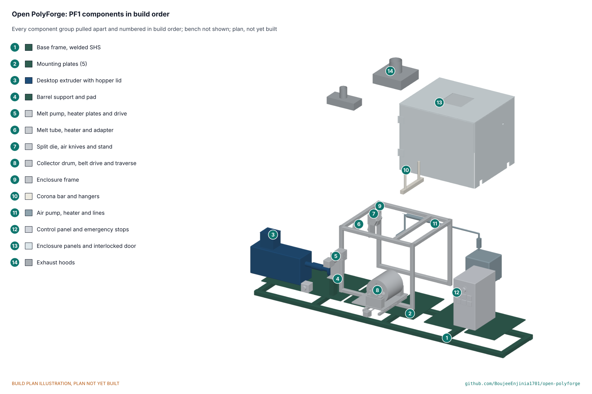

Figure 1. The PF1 machine in build order.

A bench-top melt-blowing machine on a welded steel frame that sits on a 2 ft x 8 ft workbench. From left to right: a desktop screw extruder, then, inside a clear, exhausted, guard-locked enclosure, a heated melt gear pump, a split stainless die with two air knives, a 200 mm collector drum on a traversing carriage and a corona bar above it; outside on the right, the air pump, and the control panel. The parts cost about USD 14,075 (bill of materials).

## 2. What changed to make it buildable

| The concept had | The constructable design has | Why |
| --- | --- | --- |
| A die needing 5 or 6 axis machining for 40 drilled holes | A die split along its centre line, with 40 grooves 0.27 mm square cut into one lapped face on a 3-axis mill | A milling job, and the die opens for cleaning |
| A die as wide as a laboratory die | A die with 48 mm air slots | The air heater sets the power; this is what one 15 A circuit carries |
| Air knives parallel to the whole nose face | A 5 mm land at 0.30 mm with a 2 mm plenum behind it | The long narrow slot would need more pressure than the air pump makes |
| Modules placed on a bench | A welded frame, five plates on M8 bolts into rivet nuts | Nuts inside a closed steel section cannot be reached |
| Hot parts on steel | Glass-mica insulator pads under the die, pump and barrel | Keeps the frame cool and the heat in the die |
| The drum motor on the shaft end | The motor beside the drum on a timing belt | The end motor would hit the back panel at full traverse |
| The extruder in the open | A branch fume hood over its outlet and a fixed perforated lid on the hopper | Fumes and the screw are outside the enclosure |
| A drum collector running continuously | A sheet built on the drum, then cut off with the melt pump stopped | Opening the door stops the drum; the die must not keep spraying |

## 3. Making the components

### 3.1 Base frame

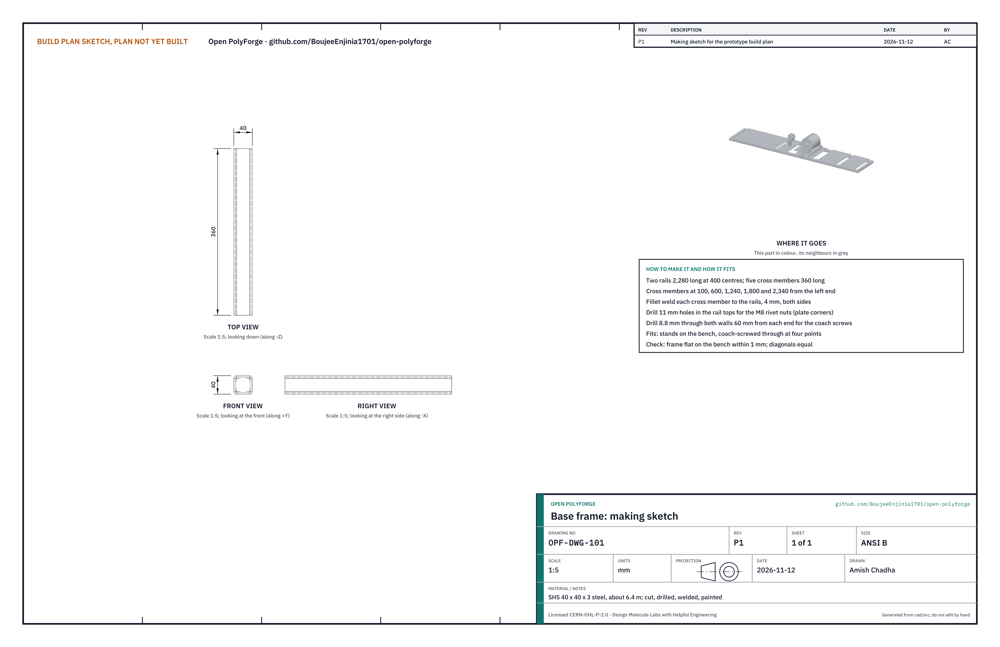

Figure 2. Base frame (OPF-DWG-101).

Made from about 6.4 m of 40 x 40 x 3 mm square steel tube.

1. Cut two rails 2,280 mm long and five cross members 360 mm long, ends square.
2. Lay the rails 400 mm apart, centre to centre, on a flat table. Place the cross members at 100, 600, 1,240, 1,800 and 2,340 mm from the left end.
3. Tack, check the diagonals are equal, then weld each joint with 4 mm fillet welds on both vertical sides.
4. Drill 11 mm holes in the rail tops at every plate corner (positions on the general arrangement drawing) and set M8 rivet nuts in them.
5. Drill 8.8 mm holes through both walls of each rail, 60 mm from each end, for the bench screws. Paint.

How it fits: the frame stands on the bench and is held by four M8 x 80 mm coach screws.

Check before moving on: the frame lies flat on the bench within 1 mm at every corner.

### 3.2 Mounting plates

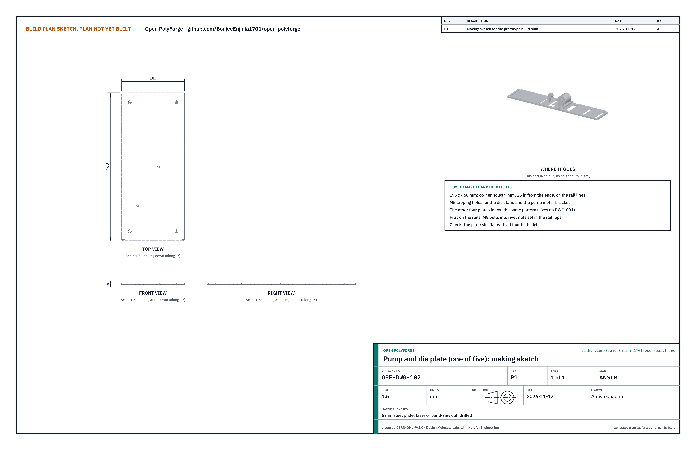

Figure 3. Pump and die plate, one of five (OPF-DWG-102).

Five 6 mm steel plates (extruder, pump and die, collector, air pump, control panel), cut and drilled. Each has 9 mm holes at its four corners on the rail lines, 25 mm in from its ends, and tapped or clearance holes for what stands on it.

How it fits: each plate sits on both rails and is held by four M8 x 16 mm bolts and washers into the rivet nuts.

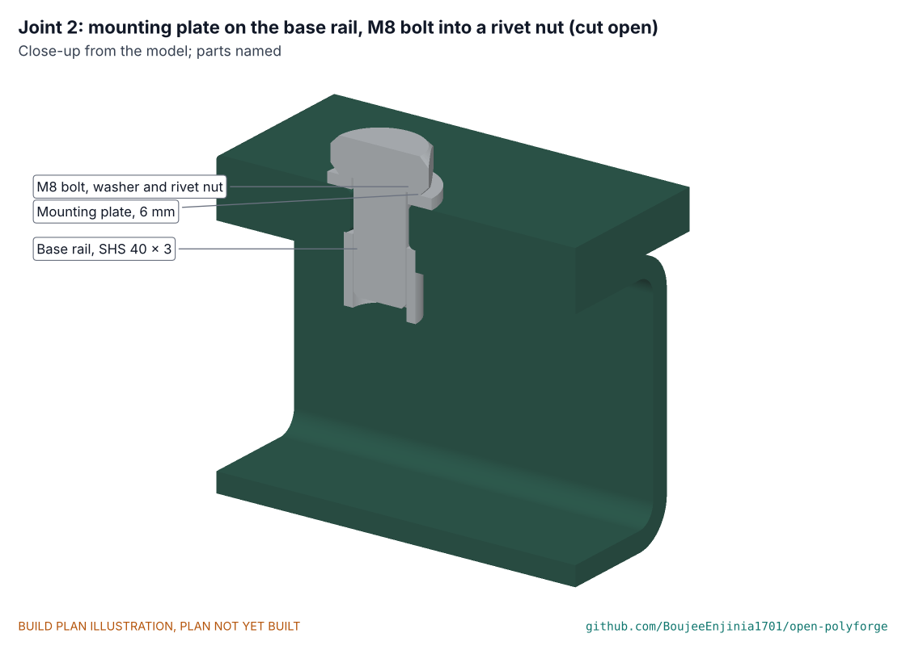

Figure 4. Joint 2: the plate is bolted into a rivet nut in the rail's top wall.

Check before moving on: every plate sits flat with all four bolts tight.

### 3.3 Split die body

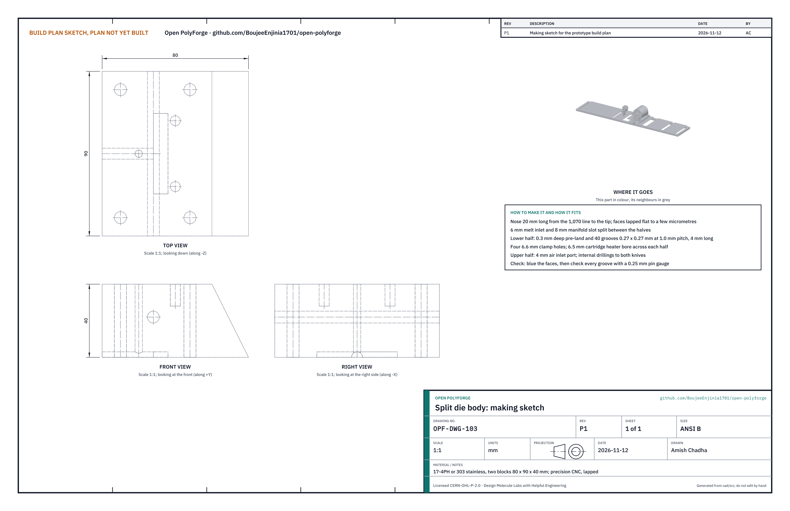

Figure 5. Split die body (OPF-DWG-103).

Two blocks of 17-4PH or 303 stainless, 80 x 90 x 40 mm each, machined by a precision CNC shop. This and the air knives are the only precision parts.

1. Machine both halves with the nose: a 20 mm long wedge ending in a sharp tip on the split line.
2. Lap the two mating faces flat to a few micrometres; check with marking blue.
3. In both halves cut the 6 mm melt inlet and the 8 mm manifold slot across the die, half in each.
4. In the lower half only, cut the 0.3 mm deep pre-land and then the 40 grooves, 0.27 x 0.27 mm, at 1.0 mm pitch, 4 mm long, ending at the tip.
5. Drill the four 6.6 mm clamp holes, the 6.5 mm heater bore across each half and the 4 mm air port in the upper half; drill the internal air passages to both knives.

How it fits: the halves clamp together with four M6 screws; a cartridge heater goes in each half and a thermocouple in the lower half.

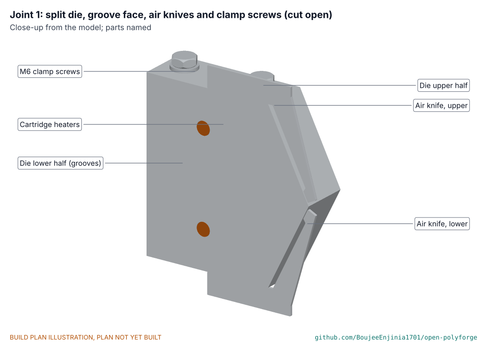

Figure 6. Joint 1: the grooved face, the knives and the clamp screws.

Check before moving on: every groove takes a 0.25 mm pin gauge and none takes 0.29 mm; blue shows contact over the whole face.

### 3.4 Air knives

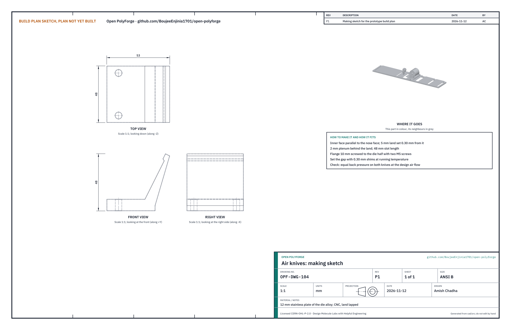

Figure 7. Air knives (OPF-DWG-104).

Two 12 mm plates of the same stainless as the die. The inner face runs parallel to the nose face: a 5 mm lapped land 0.30 mm from the nose, then a 2 mm deep plenum behind it, over a 48 mm length. A 10 mm flange screws to the die half with two M5 screws.

How it fits: set each gap with 0.30 mm shims with the die at running temperature, then tighten the screws.

Check before moving on: with air on, the back pressure under each knife is the same within 10 %.

### 3.5 Melt tube and adapter

Figure 8. Melt tube and adapter (OPF-DWG-105).

Turned from 303 stainless bar. The melt tube is 25 mm across with a 6 mm bore and a 100 mm flange with four 6.6 mm holes on an 80 mm circle to suit the extruder outlet; the adapter is 30 mm across, 20 mm long, with a 6 mm bore. Faces square and smooth. A 100 W band heater clamps onto the melt tube.

Check before moving on: the faces seat without light showing between them and the parts they meet.

### 3.6 Collector drum

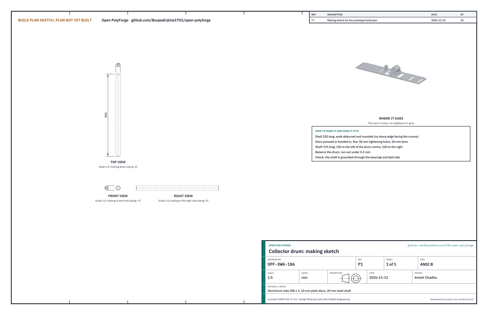

Figure 9. Collector drum (OPF-DWG-106).

An aluminium tube 200 mm across, 3 mm wall, 220 mm long, with two 10 mm aluminium end discs and a 20 mm steel shaft 375 mm long. Round and deburr both ends of the tube: no sharp edge may face the corona needles. Press or bond the discs in, fit the shaft and balance.

Check before moving on: run-out under 0.2 mm when spun in the bearings.

### 3.7 Drum carriage and brackets

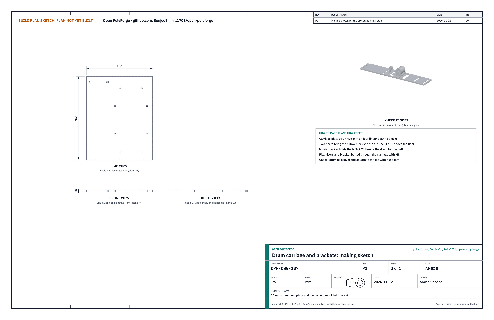

Figure 10. Drum carriage, bearing risers and motor bracket (OPF-DWG-107).

A 10 mm aluminium carriage plate on four linear bearing blocks; two aluminium risers that lift the pillow blocks so the drum axis is level with the die; a 6 mm aluminium bracket that holds the drum motor beside the drum.

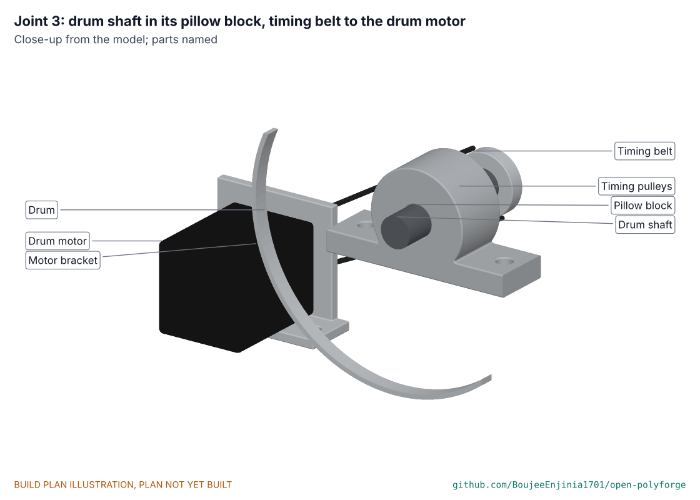

Figure 11. Joint 3: the drum shaft runs in a pillow block and is driven by a timing belt from the motor beside the drum.

Check before moving on: drum axis level, square to the die and at die height within 0.5 mm.

### 3.8 Corona bar

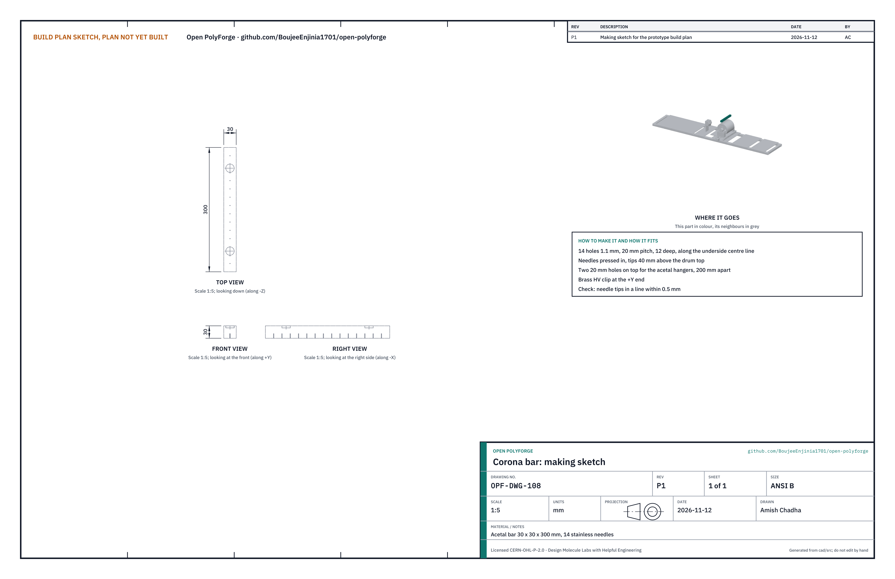

Figure 12. Corona bar (OPF-DWG-108).

An acetal bar 30 x 30 x 300 mm with 14 holes of 1.1 mm at 20 mm pitch along its underside, 12 mm deep, and two 20 mm holes on top for the hangers. Press in 1 mm stainless needles so their tips stand in a line. Fit the brass high-voltage clip at the back end.

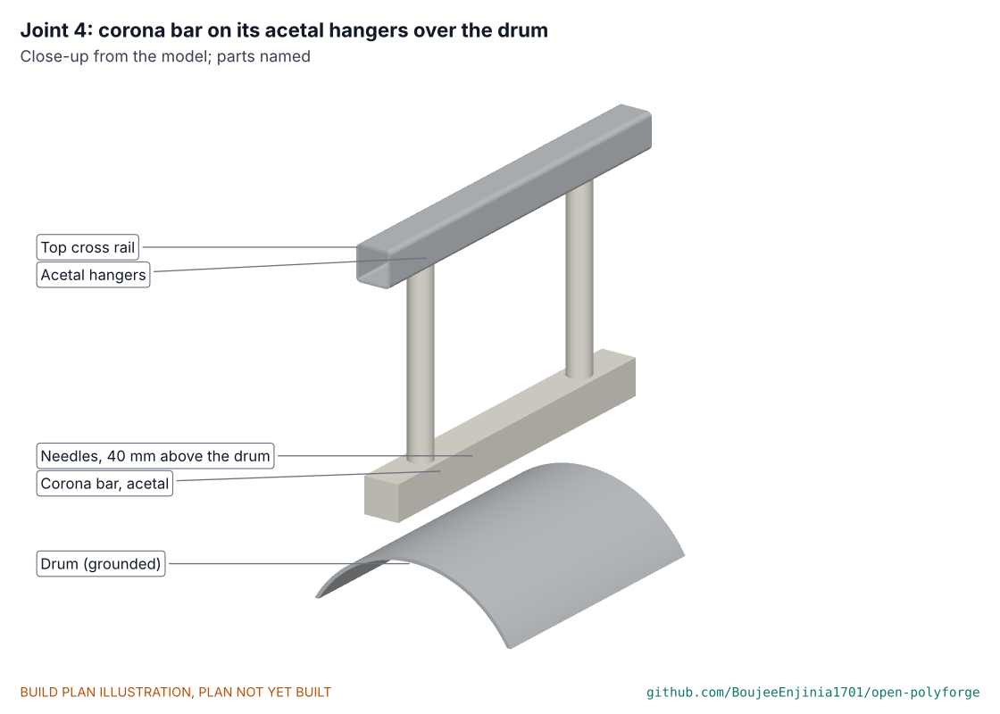

Figure 13. Joint 4: the bar hangs from the enclosure's top cross rail on two acetal rods, its needles 40 mm above the drum.

Check before moving on: needle tips in a line within 0.5 mm; 40 mm to the drum top at every needle.

### 3.9 Enclosure frame and panels

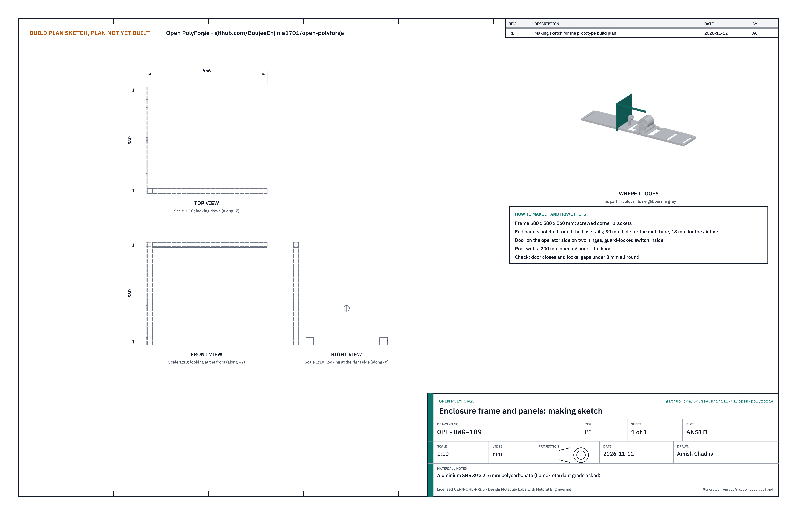

Figure 14. Enclosure frame and panels (OPF-DWG-109).

A frame of 30 x 2 mm aluminium square tube, 680 x 580 x 560 mm, with a top cross rail for the corona bar, clad in 6 mm polycarbonate (ask for a flame-retardant grade). The end panels are notched round the base rails and drilled for the melt tube (30 mm) and the air line (18 mm). The door on the operator side hangs on two hinges; the guard-locking switch sits inside on the post. The roof has a 200 mm opening under the hood.

Check before moving on: the door shuts and locks; gaps under 3 mm all round.

### 3.10 Exhaust hoods

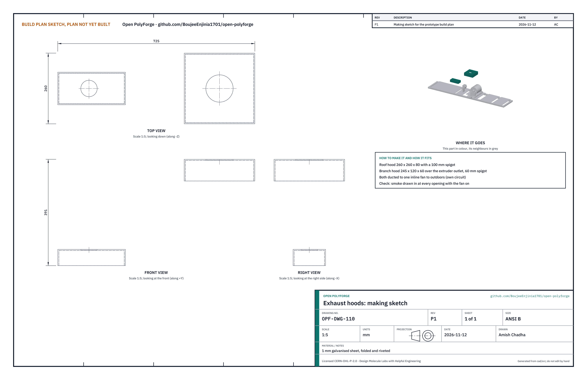

Figure 15. Exhaust hoods (OPF-DWG-110).

Folded from 1 mm galvanised sheet: a 260 x 260 x 80 mm hood on the roof with a 100 mm spigot, and a 245 x 120 x 60 mm branch hood over the extruder outlet with a 60 mm spigot, screwed to the enclosure end panel. Both join one duct to an inline fan exhausting outdoors, wired to its own building circuit.

Check before moving on: smoke from a smoke pencil is drawn in at every opening with the fan running.

### 3.11 Bought components

- **Desktop extruder:** a 5/8 in screw, L/D 12 filament-type extruder, 110 V. Adapt its outlet flange to the melt tube's four-hole pattern.
- **Melt gear pump:** 0.16 cm3 per revolution, rated to 510 C; fit the two aluminium heater plates with their 100 W cartridges.
- **Air pump:** linear diaphragm type, 200 normal litres per minute at 20 kPa, 115 V; fit a check valve on its outlet.
- **Air heater:** 1,000 W, 120 V inline stainless heater, 430 C maximum; insulate its body; fit the low-flow pressure switch at its inlet.
- **High-voltage supply:** 0 to -30 kV, 1 mA, current-limited, fixed negative, with an enable input.
- **Control panel:** steel enclosure, main switch, branch protection, solid-state relays, four PID controllers, safety relay, current sensor, motion controller; two emergency stop buttons.
- **Ozone monitor, extinguisher and protective equipment:** at the bench.

## 4. Putting it together

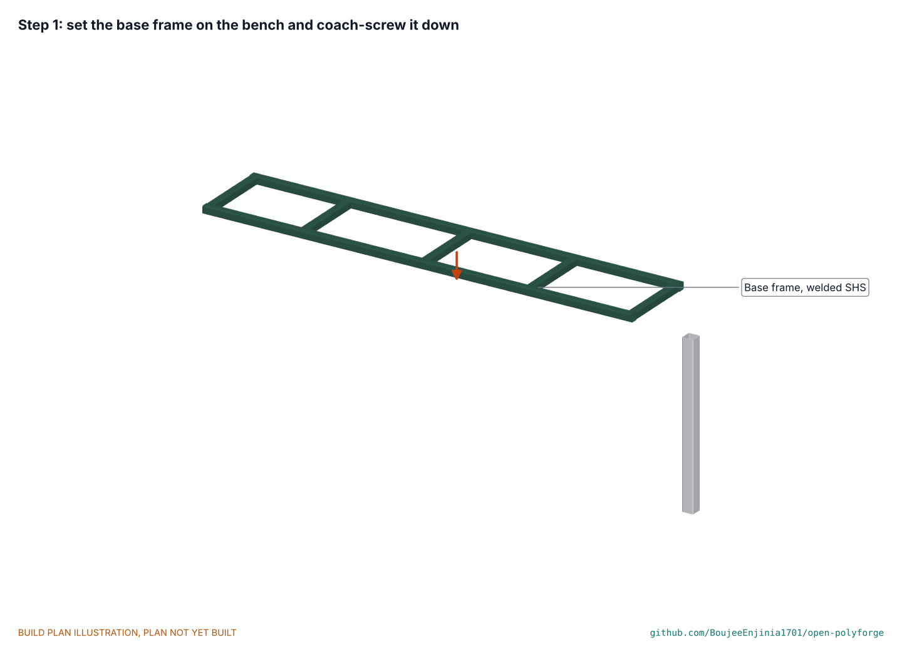

Figure 16. Step 1: set the base frame on the bench; drive four M8 x 80 mm coach screws through it into the bench top.

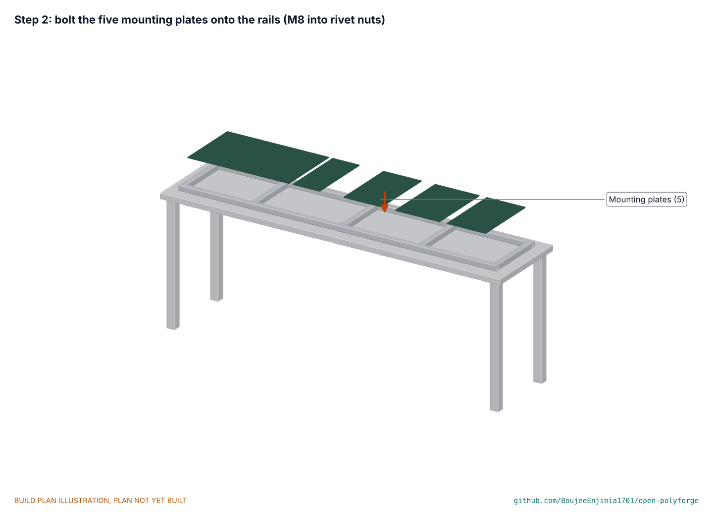

Figure 17. Step 2: bolt the five plates onto the rails with M8 x 16 mm bolts and washers into the rivet nuts.

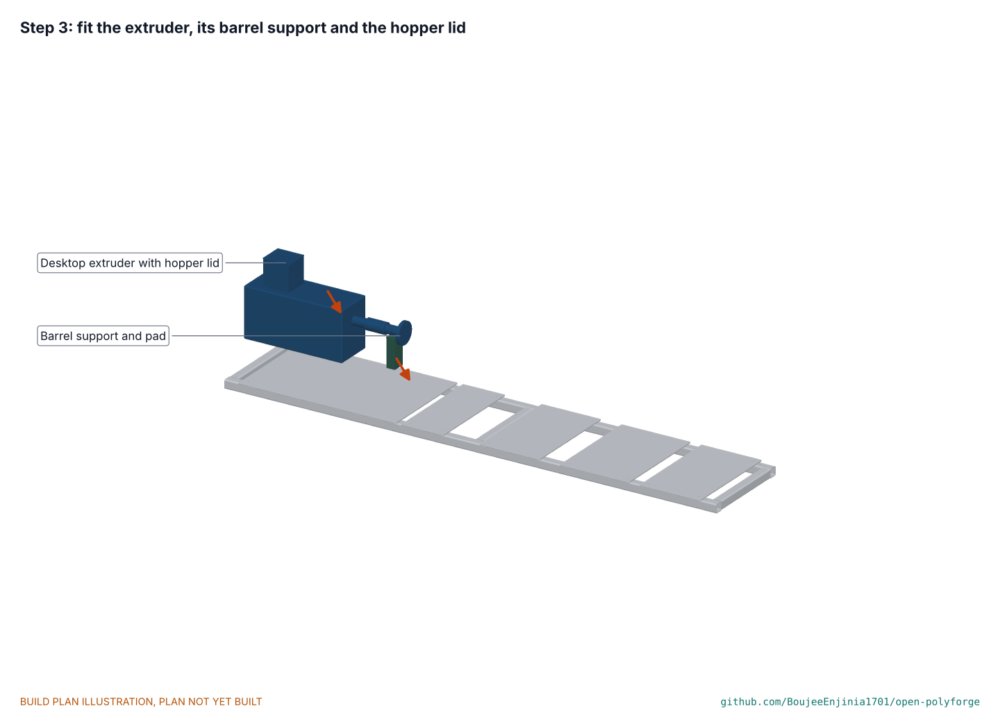

Figure 18. Step 3: stand the extruder on its plate, set the barrel support and insulator pad under the barrel, and screw the perforated lid onto the hopper.

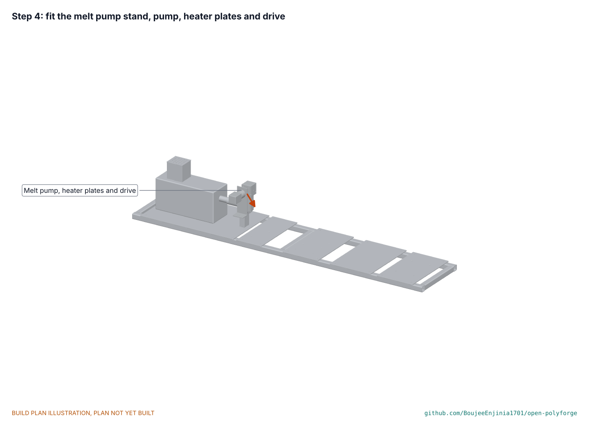

Figure 19. Step 4: fit the melt pump stand and pad, the pump with its heater plates (four M5 through-bolts), the bracket, gearbox, coupling and motor.

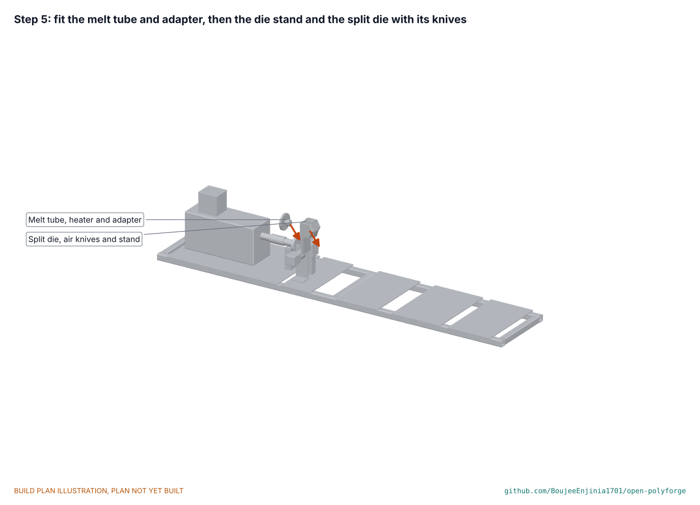

Figure 20. Step 5: bolt the melt tube to the extruder flange (four M6), fit its band heater; fit the die stand and pad, the adapter, the clamped die and the knives. Hold point: set the knife gaps hot later, at first heat.

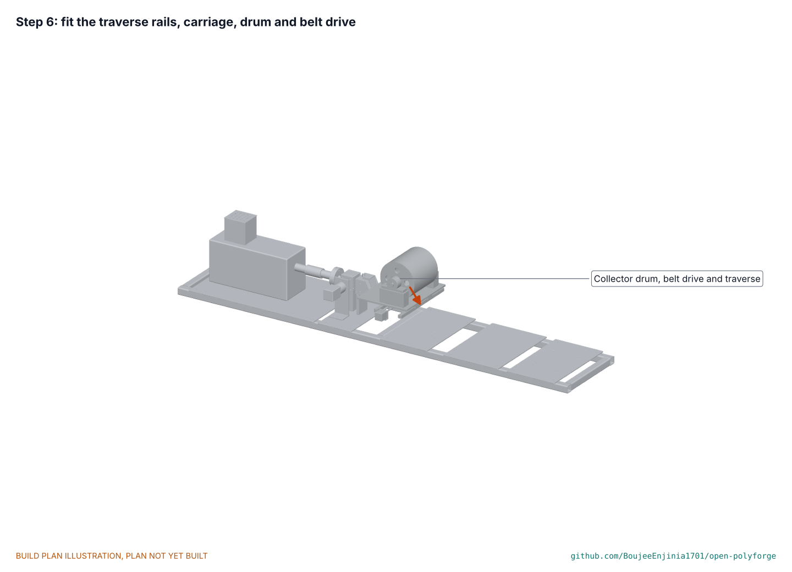

Figure 21. Step 6: fit the two linear rails, the bearing blocks, the carriage, the lead screw and its motor; then the risers, pillow blocks, drum, pulleys, belt and drum motor. Set the drum 200 mm from the die tip.

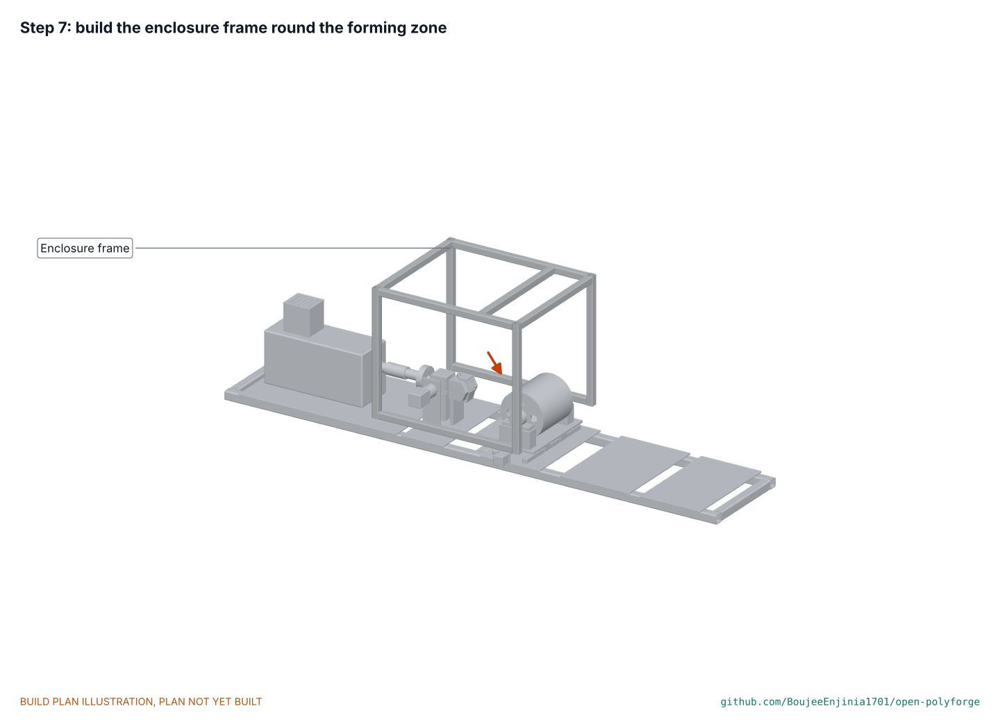

Figure 22. Step 7: build the enclosure frame round the forming zone and screw its bottom rails to the bench.

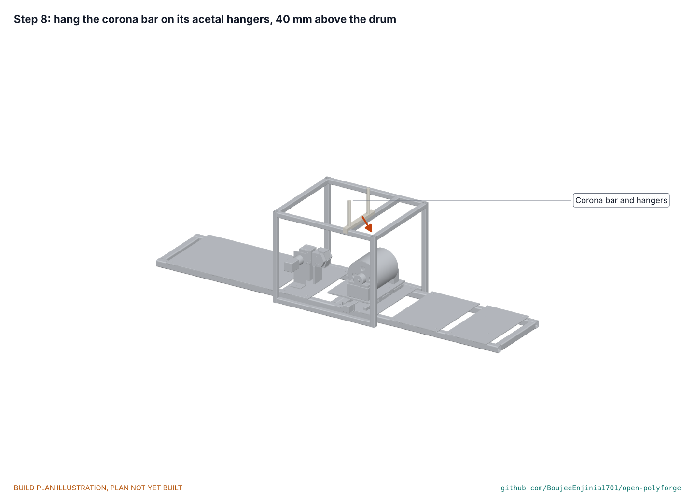

Figure 23. Step 8: hang the corona bar from the top cross rail on its two acetal hangers; set the needles 40 mm above the drum.

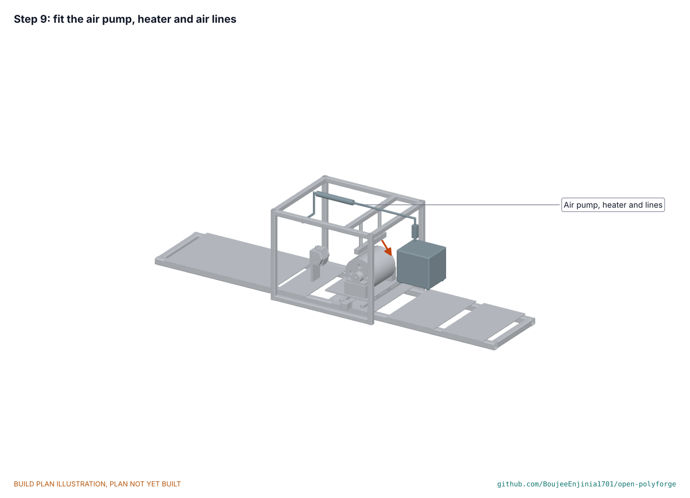

Figure 24. Step 9: stand the air pump on its feet, fit the heater along the back of the enclosure, and run the cold line (with the flow meter and bleed valve) and the insulated hot line to the die.

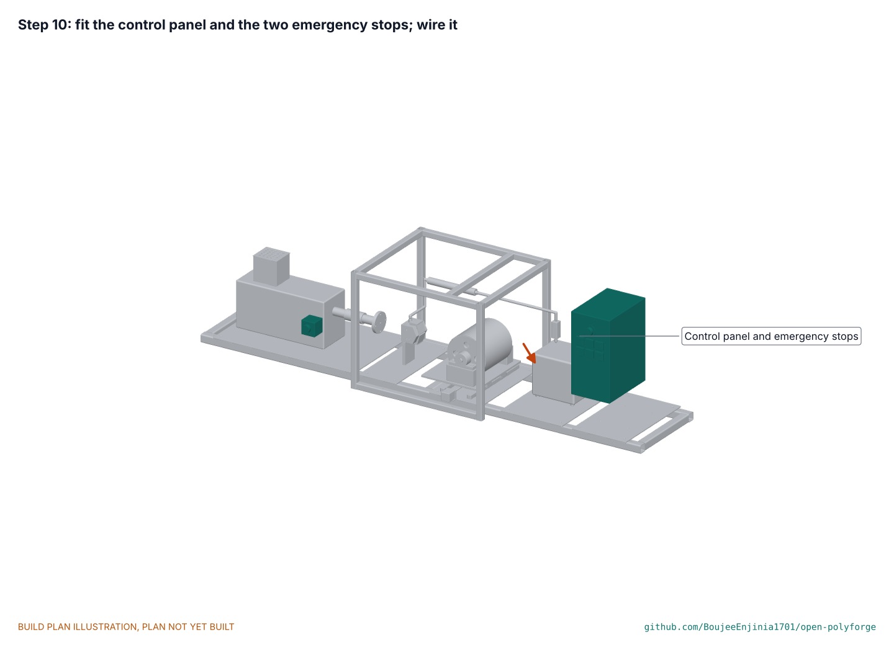

Figure 25. Step 10: fit the control panel and the operator-side emergency stop; wire heaters, thermocouples, motors, interlocks and the high-voltage enable. Hold point: wiring inspection before any power.

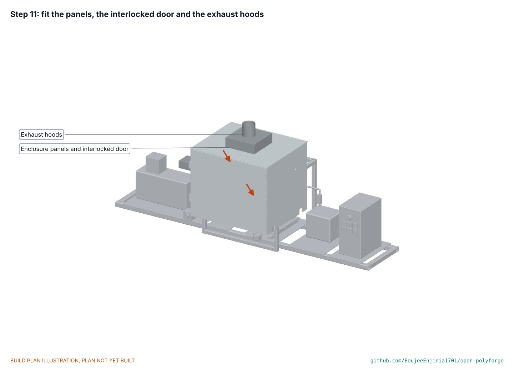

Figure 26. Step 11: fit the panels, the roof and the door with its guard-locking switch; fit the hoods and connect the duct.

## 5. First checks

Each check is listed here and recorded only in a TRL 4 test report.

| Check | Requirement | Pass when |
| --- | --- | --- |
| Interlocks and stops: open the door, press each emergency stop, with heaters and motors off | PR-012, PR-013 | Drum, traverse, pump and HV enable all drop out |
| Warm-up under the load manager | PR-001, PR-002 | Line current never above 12 A; zones reach set point |
| Air on, die hot: flow, pressures, heater outlet | PR-025, PR-006 | 122 normal litres per minute; equal knife pressures; 270 C |
| Purge with low-MFR PP into the catch tray | PR-023 | Clean, steady flow from all 40 grooves |
| First web at 4 g/min | PR-005, PR-007 | A sheet forms; basis weight measured |
| High voltage stepped up to -25 kV with the door shut | PR-010 | No spark-over; current at or below 1 mA |
| Exhaust and ozone at the operator | PR-014, PR-015 | Flow 0.10 m3/s or more; ozone under 0.1 ppm |
| Outside surface temperatures | PR-024 | 60 C or less |

## 6. Safety stops

> **Safety:** Work stops at each of these points until the condition is met.

- **Before any power:** a qualified electrician has inspected the panel, earthing and the receptacle and circuit (15 A or as decided).
- **Before the first heat:** both emergency stops and the door interlock have been proven with the heaters disconnected; the over-temperature cut-outs are set at 300 C; the extinguisher is at the bench.
- **Before the air heater is switched on:** the air pump runs and the low-flow pressure switch has been proven to cut the heater.
- **Before any melt is pumped:** the exhaust runs with its airflow proven; face shield, heat-resistant gloves and apron are worn; the catch tray is in place; the door is shut.
- **Before high voltage:** the drum is grounded, the door is shut and locked, the ozone monitor is on, and the grounding stick is at hand; the bar is grounded before every entry.
- **Before any web leaves the bench:** it is labelled as test media. No media from this prototype is used in a mask or respirator until its efficiency, pressure drop and charge decay are measured by a qualified laboratory and the finished product is certified to its own standard.

## 7. Tools, skills and workspace

- A welder and a person qualified to weld the frame; a drill press; taps M5 to M8; a rivet-nut tool.
- A lathe for the melt tube and adapter; a precision CNC shop for the die halves and knives (or a skilled machinist with a 3-axis mill, a slitting saw or micro end mill, and a surface plate for lapping).
- Pin gauges 0.25 and 0.29 mm, feeler shims 0.30 mm, marking blue, a dial indicator.
- An electrician for the panel; a multimeter and a true-RMS clamp meter.
- A ventilated workshop with a duct route to outdoors, make-up air and a 15 A (or 20 A) receptacle near the bench.

## 8. Where the numbers come from

- Model: `cad/src/model.py` (option PF1), `cad/step/PF1-assembly.step`, `cad/step/PF1/`.
- Drawings: `cad/drawings/OPF-DWG-001` (general arrangement), `OPF-DWG-002` (half section), `OPF-DWG-101` to `110` (making sketches).
- Calculations: `docs/04-calcs/01-sizing.md` (OPF-CAL-001) and `sizing.py`; STEM check OPF-STM-001.
- Bill of materials: `bom/bom.csv`.

Licence: this document is licensed under CC-BY-4.0 (Creative Commons Attribution 4.0 International), following the Helpful Engineering licensing guide. Design Molecule Labs with Helpful Engineering.
